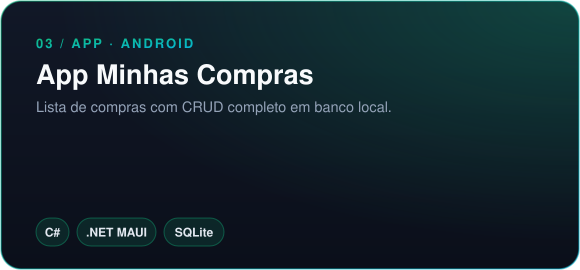
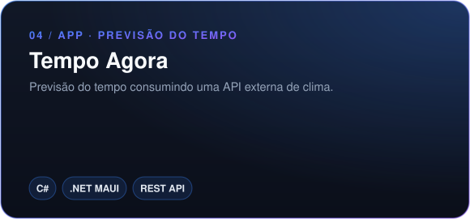
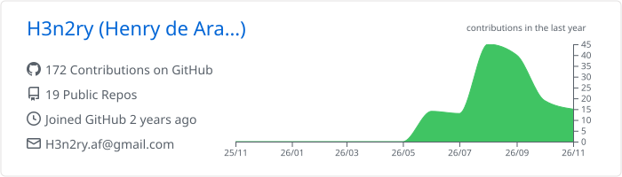
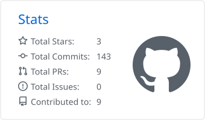
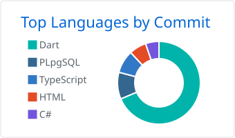

 

  

Gosto de construir apps que resolvem problemas reais 
e de integrar **IA** em experiências do dia a dia.

<h2 align="center">⚡ Foco atual</h2>

|  🔨 **Construindo** |  📚 **Estudando** |  🎯 **Objetivo** |
|:---:|:---:|:---:|
| [Muscle Champ](https://musclechamp.com.br) app fitness gamificado com IA | Serverless, edge computing e aplicações com LLMs | Produtos completos, do banco ao deploy |

 

<h2 align="center">🧰 Stack</h2>

   
  <b>FRONT-END</b>

   
  <b>MOBILE</b>

   
  <b>BACK-END &amp; INFRA</b> · também uso Hono em Workers

 

<h2 align="center">🚀 Projetos em destaque</h2>

<table>
  <tr>
    <td align="center">
       
      <a href="https://github.com/H3n2ry/muscle-champ"><b>Repositório</b></a> &nbsp;·&nbsp; <a href="https://musclechamp.com.br"><b>Demo ↗</b></a>
    </td>
    <td align="center">
       
      <a href="https://github.com/H3n2ry/af-nail"><b>Repositório</b></a> &nbsp;·&nbsp; <a href="https://af-nail.vercel.app"><b>Demo ↗</b></a>
    </td>
  </tr>
  <tr>
    <td align="center">
       
      <a href="https://github.com/H3n2ry/AppMinhasCompras"><b>Repositório</b></a>
    </td>
    <td align="center">
       
      <a href="https://github.com/H3n2ry/TempoAgora"><b>Repositório</b></a>
    </td>
  </tr>
</table>

 

<h2 align="center">📊 Estatísticas</h2>

  <picture>
    <source media="(prefers-color-scheme: dark)" srcset="./profile-summary-card-output/github_dark/0-profile-details.svg" />
    
  </picture>

  <picture>
    <source media="(prefers-color-scheme: dark)" srcset="./profile-summary-card-output/github_dark/3-stats.svg" />
    
  </picture>
  <picture>
    <source media="(prefers-color-scheme: dark)" srcset="./profile-summary-card-output/github_dark/2-most-commit-language.svg" />
    
  </picture>

  
  © Henry Fernandes

